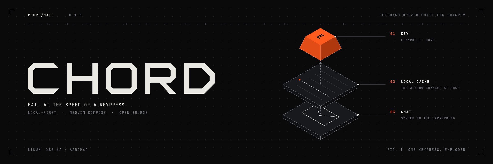
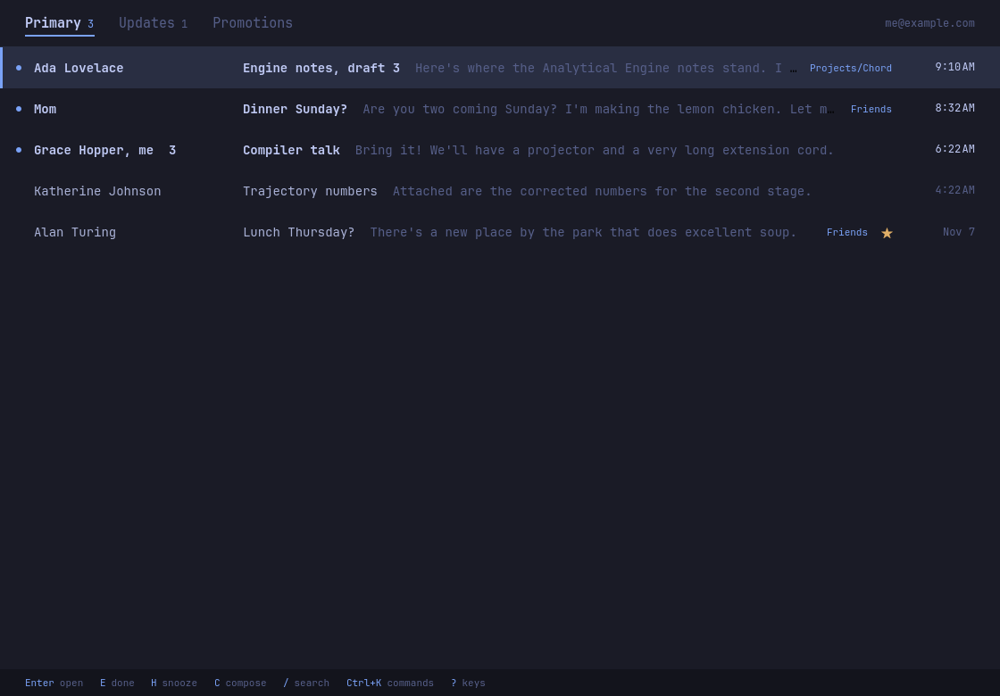
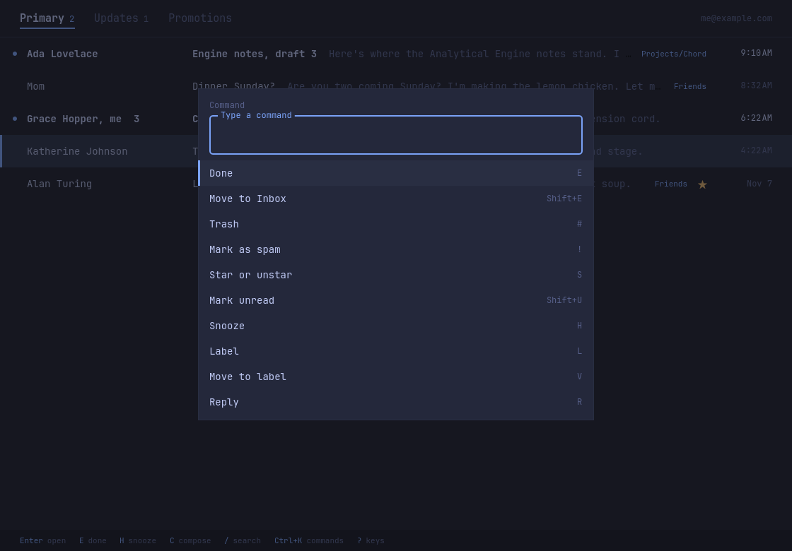
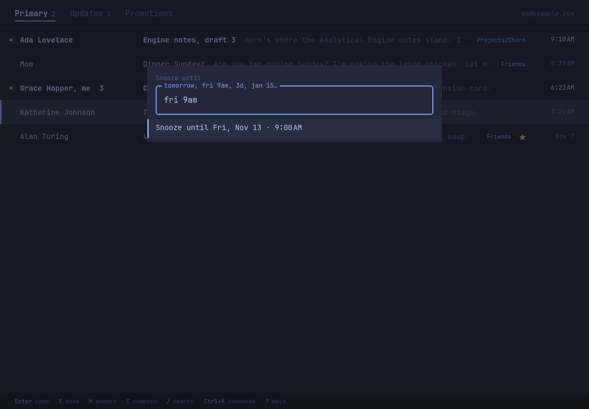
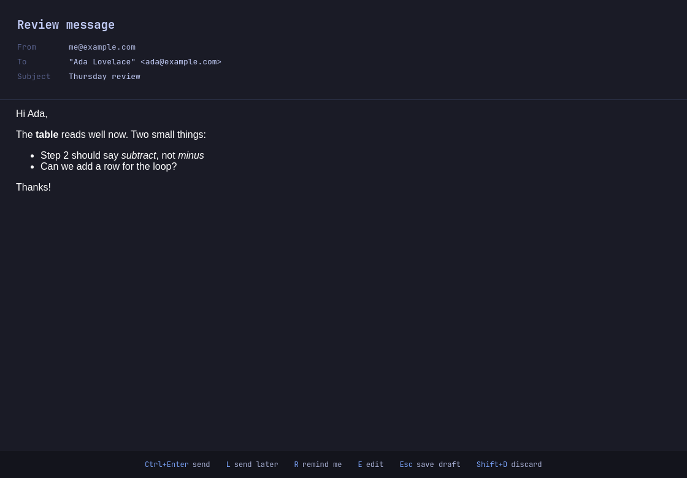
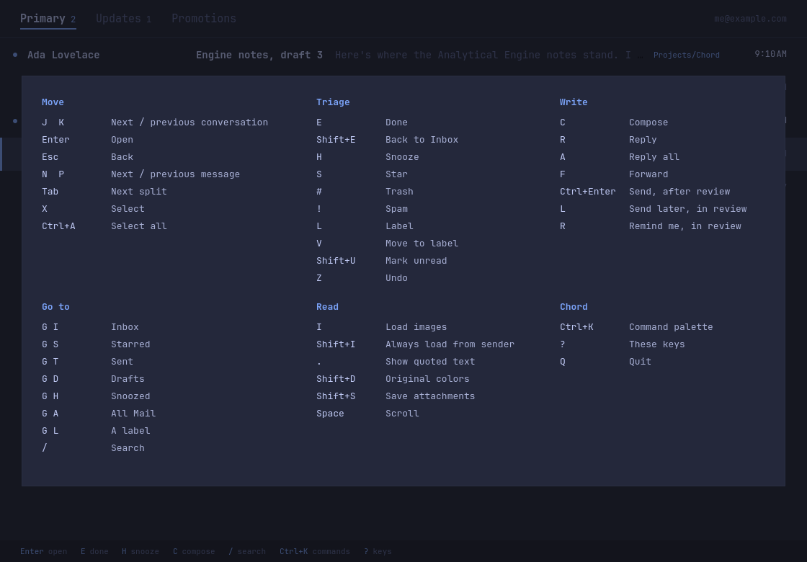
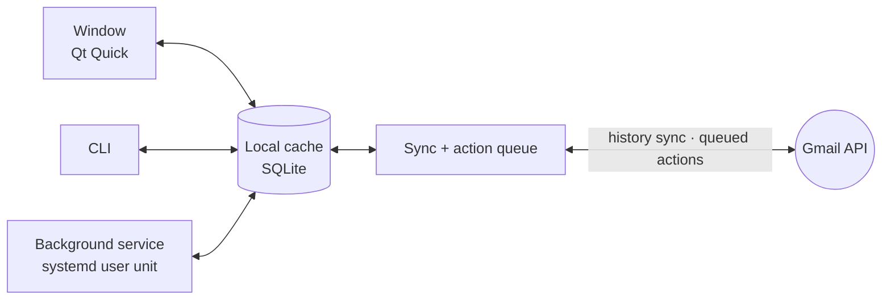

<div align="center">



<br>
<br>

**Keyboard-driven Gmail for Omarchy.**<br>
Fast, focused, and local-first. Free and open source.

<br>

[](https://github.com/thetylerreiff/chord-mail/actions/workflows/ci.yml)
[](LICENSE)
[](https://omarchy.org)
[](#how-it-works)

[Install](#install) · [Connect Gmail](#connect-gmail) · [Keys](#keys) · [Command line](#command-line) · [Settings](#settings) · [Development](#development)

<br>



</div>

<br>

## Features

- ⚡ **Instant.** Everything you see comes from a local cache, and sync runs
  in the background from Gmail's history log. After the first sync, Chord
  only moves what changed.
- ⌨️ **Triage from the keyboard.** `e` is done, `h` snoozes, `#` trashes, and
  `z` undoes any of it. Every action shows at once and reaches Gmail in the
  background, even if you're offline when you press it.
- 🗂️ **Split inbox.** Primary, Updates, and Promotions tabs come from Gmail's
  own categories, or you can write your own rules in `config.toml`.
- ✍️ **Write in Neovim.** `c`, `r`, `a`, and `f` open Neovim in a floating
  terminal on a Markdown draft. Chord shows you what will be sent, adds your
  Gmail signature and the quoted thread, and holds the message for 10 seconds
  so you can undo it.
- ⏰ **Snooze, reminders, and send later.** `fri 9am`, `3d`, and `jan 15` all
  work. A background service brings mail back and sends scheduled mail even
  when the window is closed.
- 🛡️ **Private reading.** Remote images and trackers stay blocked until you
  press `i`. Messages render without JavaScript, links open in your browser,
  and nothing a message loads is kept on disk.
- 🎨 **Omarchy-native.** Chord follows your theme live, darkens bright HTML
  mail to match, uses your window rounding and font, and shows your wallpaper
  at inbox zero.
- 🤖 **Scriptable.** Every command works without a display and speaks
  `--json`, so scripts and AI agents can read and triage your mail.

<table>
  <tr>
    <td width="50%"><p align="center"><sub><b>Ctrl+K</b> opens the command palette for every action</sub></p></td>
    <td width="50%"><p align="center"><sub><b>h</b> snoozes until any time you can type</sub></p></td>
  </tr>
  <tr>
    <td width="50%"><p align="center"><sub>Write in Neovim, then review it before it's sent</sub></p></td>
    <td width="50%"><p align="center"><sub><b>?</b> shows every key</sub></p></td>
  </tr>
</table>

## Install

Chord is built for [Omarchy](https://omarchy.org) on Arch Linux, on x86_64 and
aarch64. Building it needs Rust, from [rustup](https://rustup.rs) or
`pacman -S rust`.

```sh
git clone https://github.com/thetylerreiff/chord-mail
cd chord-mail
bin/install                                # build the Arch package and install it
chord-mail default                         # make Chord the system's email app (mailto: links)
systemctl --user enable --now chord-mail   # background sync, snoozes, and notifications
```

`bin/install` uses `makepkg`, which installs Chord's dependencies (Qt 6,
Neovim, `lld`) with pacman. Chord then appears in the app launcher.

## Connect Gmail

Chord talks to Gmail through **your own** Google Cloud OAuth client, so your
mail goes straight from Google to your machine and no third party ever sees
it. Setup takes about five minutes, and you only do it once.

1. Open [Google Cloud Console](https://console.cloud.google.com/) and create a
   project named `Chord`.
2. Under **APIs & Services → Library**, enable the **Gmail API**.
3. Open **Google Auth Platform** and fill in **Branding**, with `Chord` as the
   app name and your email as the support contact. Under **Audience**, choose
   **External** and add your Gmail address as a test user.
4. Under **Clients**, create a client of type **Desktop app**, download its
   JSON, and save it as `~/.config/chord-mail/client_secret.json`.
5. Back under **Audience**, click **Publish app**.

> [!NOTE]
> Google expires the sign-ins of apps in *Testing* after seven days, which is
> why step 5 publishes the app. Publishing doesn't make it public or verified.
> Google just shows a warning during sign-in, and **Advanced → Go to Chord**
> continues past it.

Then open Chord (`Super+Space`, "Chord") and press `Enter` to sign in.

## Keys

The keys follow Gmail's own shortcuts, so your habits carry over. Press `?` in
the window to see them all.

| Key | In the list | In a conversation |
|---|---|---|
| `j` `k` | Next / previous | Next / previous conversation |
| `Enter` / `Esc` | Open / clear | Back to the list |
| `e` | Done (archive) | Done, then the next one |
| `h` | Snooze | Snooze |
| `#` | Trash | Trash |
| `z` | Undo | Undo |
| `c` `r` `a` `f` | Compose | Compose, reply, reply all, forward |
| `/` | Search with Gmail syntax | Search |
| `Ctrl+K` | Command palette | Command palette |

<details>
<summary><b>Every key</b></summary>

<br>

| Key | In the list | In a conversation |
|---|---|---|
| `j` `k` | Next / previous | Next / previous conversation |
| `Enter` | Open | |
| `Esc` | Clear selection, leave search | Back to the list |
| `n` `p` | | Next / previous message |
| `Tab` `Shift+Tab` | Next / previous split | |
| `e` | Done (archive) | Done, then the next one |
| `Shift+E` | Back to the inbox | Back to the inbox |
| `h` | Snooze | Snooze |
| `s` | Star | Star |
| `#` | Trash | Trash |
| `!` | Spam | Spam |
| `l` / `v` | Label / move to label | Label / move to label |
| `Shift+U` | Mark unread | Mark unread and go back |
| `x`, `Ctrl+A` | Select, select all | |
| `r` `a` `f` | | Reply, reply all, forward |
| `c` | Compose | Compose |
| `/` | Search (Gmail syntax) | Search |
| `g` then `i` `s` `t` `d` `h` `a` `l` | Inbox, starred, sent, drafts, snoozed, all mail, a label | |
| `i` / `Shift+I` | | Load images / always for this sender |
| `.` | | Show quoted text |
| `Shift+D` | | Original colors |
| `Shift+S` | | Save attachments to Downloads |
| `z`, `Ctrl+Z` | Undo | Undo |
| `Ctrl+K` | Command palette | Command palette |
| `q` | Quit | Quit |

When Neovim closes, Chord shows a review screen, where:

| Key | Action |
|---|---|
| `Ctrl+Enter` | Send |
| `l` | Send later |
| `r` | Remind me if there's no reply |
| `e` | Edit again |
| `Esc` | Save to Drafts |
| `Shift+D` | Discard |

</details>

## Writing mail

A draft is a few headers, a blank line, and Markdown:

```text
To: Ada Lovelace <ada@example.com>
Cc:
Subject: Thursday review
Attach: ~/notes.pdf

The **table** reads well now. Two small things:

- Step 2 should say *subtract*
- Can we add a row for the loop?
```

Chord sends HTML along with a plain-text copy. Single line breaks are kept. A
name without an address, such as `ada`, resolves to the one contact it
matches. If it matches several, the review screen says so. Save and quit
(`:wq`) to review the message, or quit without saving (`:cq`) to discard it.

## Command line

Every command runs without a display, takes `--json` where it prints data,
and exits 0 on success or 1 with the error on stderr.

| Command | What it does |
|---|---|
| `chord-mail` / `chord-mail open` | Open the window, or bring it forward |
| `chord-mail compose [mailto:…]` | Write a new message |
| `chord-mail login` / `logout` | Sign in or out |
| `chord-mail sync` | Push queued actions and fetch what changed |
| `chord-mail inbox [--split Primary]` | List the inbox from the cache |
| `chord-mail search "<query>"` | Search all mail with Gmail syntax |
| `chord-mail show <thread>` | Print a conversation |
| `chord-mail act archive <thread>…` | Archive, trash, star, or mark conversations |
| `chord-mail daemon` | Run the background service (systemd runs it for you) |
| `chord-mail default` | Become the system's email app |
| `chord-mail skill install` | Teach Claude Code to use these commands |

```sh
# Unread mail in Primary, as JSON
chord-mail inbox --split Primary --json | jq '.[] | select(.unread)'
```

The CLI can't send mail on purpose. Agents can read, search, triage, and open a
draft, but a person reviews and sends from the window.

## Settings

Chord writes `~/.config/chord-mail/config.toml` with its defaults on first
run:

```toml
[[split]]
name = "Primary"            # no rules: takes everything else

[[split]]
name = "Updates"
labels = ["CATEGORY_UPDATES", "CATEGORY_FORUMS"]

[[split]]
name = "Code"
senders = ["@github.com"]   # addresses or @domains

[notify]
splits = ["Primary"]        # which splits notify for new mail

[sync]
interval = 60               # seconds between background syncs

[compose]
undo_seconds = 10
```

## Privacy and security

Chord asks for the `gmail.modify` scope, which lets it read, label, archive,
trash, and send. It can't permanently delete mail. Everything it stores stays
on your machine:

| Path | Contents |
|---|---|
| `~/.config/chord-mail/client_secret.json` | Your OAuth client |
| `~/.config/chord-mail/config.toml` | Settings |
| `~/.local/share/chord-mail/token.json` | Your sign-in (mode 0600) |
| `~/.local/share/chord-mail/mail.db` | The cache, action queue, snoozes, and schedule |
| `~/.cache/chord-mail/drafts/` | Drafts while Neovim has them open |

`chord-mail logout` deletes the saved sign-in. To remove everything, also
delete the three `chord-mail` directories above.

## How it works



The window only ever reads the local cache, so it never waits on the network.
An action like archive changes the cache at once and joins a queue. The queue
goes to Gmail in order in the background, and an action that fails for a
passing reason, such as being offline, is retried on the next sync. Undo puts back
both the cache and Gmail. The window and the background service are separate
processes that share the database, and a file lock keeps them from syncing at
the same time.

The code is in two crates:

- **`core/`** is the mail engine, with no UI: OAuth, the Gmail client, the
  SQLite store, sync, the action queue, rendering, composing, and the service
  tick.
- **`app/`** is the `chord-mail` binary: the CLI, the background service, and
  the window, which bridges Rust objects to QML with
  [cxx-qt](https://github.com/KDAB/cxx-qt).

[`PLAN.md`](PLAN.md) records the design decisions behind v1.

## Development

Building needs Rust, Qt 6, and the `lld` linker:

```sh
sudo pacman -S --needed base-devel lld qt6-base qt6-declarative qt6-webengine qt6-wayland
```

```sh
bin/build    # release binary at target/release/chord-mail
bin/test     # every test; none of them touch the network or your mail
dev/tour     # screenshots of every screen from a made-up mailbox, offscreen
dev/banner.py docs/banner.png   # redraws the banner above (needs Pillow)
```

`dev/tour` is the quickest way to check a UI change. It seeds an invented
mailbox, drives the window offscreen, and writes a screenshot of each screen to
`target/demo/shots/`.

## Contributing

Issues and pull requests are welcome. Before opening a pull request, run
`cargo fmt`, `cargo clippy --workspace --all-targets -- -D warnings`, and
`bin/test`. CI runs the same checks. For anything larger than a fix, open an
issue first so we can agree on the approach.

## License

[MIT](LICENSE) © Tyler Reiff
